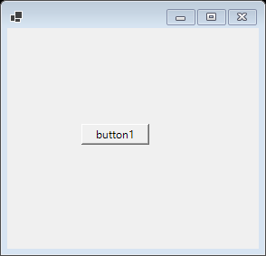
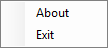
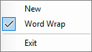

#  Verify.WinForms

[](https://github.com/orgs/VerifyTests/discussions)
[](https://github.com/VerifyTests/Verify.WinForms/actions/workflows/build.yml)
[](https://www.nuget.org/packages/Verify.WinForms/)

Extends [Verify](https://github.com/VerifyTests/Verify) to allow verification of WinForms UIs.<!-- singleLineInclude: intro. path: /docs/intro.include.md -->

**See [Milestones](../../milestones?state=closed) for release notes.**


## Sponsors


<!-- include: sponsors. path: /docs/sponsors.include.md -->
### Entity Framework Extensions

[Entity Framework Extensions](https://entityframework-extensions.net/?utm_source=simoncropp&utm_medium=Verify.WinForms) is a major sponsor and is proud to contribute to the development this project.

[](https://entityframework-extensions.net/?utm_source=simoncropp&utm_medium=Verify.WinForms)

### Developed using JetBrains IDEs

[](https://jb.gg/OpenSourceSupport)<!-- endInclude -->


## NuGet

 * https://nuget.org/packages/Verify.WinForms


## Usage

<!-- snippet: enable -->
<a id='snippet-enable'></a>
```cs
[ModuleInitializer]
public static void Init() =>
    VerifyWinForms.Initialize();
```
<sup><a href='/src/Tests/ModuleInit.cs#L3-L9' title='Snippet source file'>snippet source</a> | <a href='#snippet-enable' title='Start of snippet'>anchor</a></sup>
<!-- endSnippet -->


### Form

A visual element (Form/Control etc) can be verified as follows:

<!-- snippet: FormUsage -->
<a id='snippet-FormUsage'></a>
```cs
[Test]
public Task FormUsage() =>
    Verify(new MyForm());
```
<sup><a href='/src/Tests/TheTests.cs#L5-L11' title='Snippet source file'>snippet source</a> | <a href='#snippet-FormUsage' title='Start of snippet'>anchor</a></sup>
<!-- endSnippet -->

With the state of the element being rendered as a verified file:

[TheTests.FormUsage.DotNet.verified.png](/src/Tests/TheTests.FormUsage.DotNet.verified.png):



A `Form` is shown as the top-level window it is, but off screen and without being activated (so it does not take the focus), and messages are pumped once. So it is laid out, scaled and drawn as it appears on screen, and its `Load` and `Shown` handlers have run. It is hidden again once rendered. A form that has already been shown is rendered where it is, and left shown.


### Menus and drop-downs

Any `ToolStripDropDown` can be verified: a `ContextMenuStrip`, the `DropDown` of a `ToolStripMenuItem` or `ToolStripDropDownButton`, or a plain `ToolStripDropDown`. It is shown as the popup window it is, but off screen, so it is laid out and drawn (renderer, margins, border) as it appears on screen. It is closed again once rendered.


#### ContextMenuStrip

A `ContextMenuStrip` can be verified as follows:

<!-- snippet: ContextMenuStrip -->
<a id='snippet-ContextMenuStrip'></a>
```cs
[Test]
public Task ContextMenuStrip()
{
    var menu = new ContextMenuStrip();
    var items = menu.Items;

    items.Add(new ToolStripMenuItem("About"));
    items.Add(new ToolStripMenuItem("Exit"));
    return Verify(menu);
}
```
<sup><a href='/src/Tests/TheTests.cs#L83-L96' title='Snippet source file'>snippet source</a> | <a href='#snippet-ContextMenuStrip' title='Start of snippet'>anchor</a></sup>
<!-- endSnippet -->

With the state of the element being rendered as a verified file:

[TheTests.ContextMenuStrip.DotNet.verified.png](/src/Tests/TheTests.ContextMenuStrip.DotNet.verified.png):




#### ToolStripDropDownMenu

The menu of a `ToolStripDropDownButton` (or of a `ToolStripMenuItem`) can be verified via its `DropDown`:

<!-- snippet: ToolStripDropDownMenu -->
<a id='snippet-ToolStripDropDownMenu'></a>
```cs
[Test]
public Task ToolStripDropDownMenu()
{
    var button = new ToolStripDropDownButton("File");
    var items = button.DropDownItems;

    items.Add(new ToolStripMenuItem("New"));
    items.Add(
        new ToolStripMenuItem("Word Wrap")
        {
            Checked = true
        });
    items.Add(new ToolStripSeparator());
    items.Add(new ToolStripMenuItem("Exit"));
    return Verify(button.DropDown);
}
```
<sup><a href='/src/Tests/TheTests.cs#L98-L117' title='Snippet source file'>snippet source</a> | <a href='#snippet-ToolStripDropDownMenu' title='Start of snippet'>anchor</a></sup>
<!-- endSnippet -->

With the state of the element being rendered as a verified file:

[TheTests.ToolStripDropDownMenu.DotNet.verified.png](/src/Tests/TheTests.ToolStripDropDownMenu.DotNet.verified.png):




## OS specific rendering

The rendering of Form elements can very slightly between different OS versions. This can make verification on different machines (eg CI) problematic. There are several approaches to mitigate this:

 * Using a [custom comparer](https://github.com/VerifyTests/Verify/blob/master/docs/comparer.md)


## Icon

[Gem](https://thenounproject.com/term/gem/2247823/) designed by [Adnen Kadri](https://thenounproject.com/adnen.kadri/) from [The Noun Project](https://thenounproject.com).
